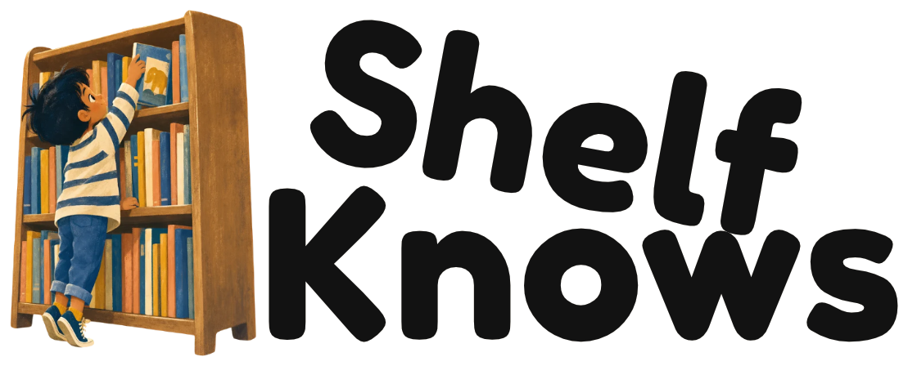

<div align="center">

  

  # ShelfKnows
  ### *Where intuition meets the stories you were looking for.*

  [](https://shelf-knows.vercel.app)
  [](https://huggingface.co/spaces/Simran09/shelfknows-api)
  [](https://react.dev)
  [](https://fastapi.tiangolo.com)
  [](https://supabase.com)

  <br />

  <p align="center">
    <b>A cozy, intelligent book recommendation sanctuary built for readers who care about how a story makes them feel.</b><br />
    Powered by hybrid semantic retrieval, neural cross-encoder reranking, and an authentic reader community.
  </p>

  <p align="center">
    <a href="https://shelf-knows.vercel.app"><b>Explore the Live App ➔</b></a>
  </p>

</div>

---

## ☕ A Note from the Creator

> *"ShelfKnows started out of my own habit of collecting books and then wondering what to read next. As a reader who loves thoughtful stories and as someone who builds software, I wanted to create something that feels like walking into a cozy, quiet bookstore with a friend who actually listens to the kind of story you crave.*
>
> *Traditional algorithms treat books like commodities — matching you with bestselling charts or generic genre tags. But stories aren't just genres; they are moods, feelings, questions, and quiet companions during difficult seasons of life.*
>
> *I built ShelfKnows so you could describe a feeling — like 'a quiet story about grief, warm coffee, and gentle hope' — and find books that truly speak to your soul.*
>
> *I hope ShelfKnows helps you find a story that stays with you long after the last page."*
>
> **— Simran Chaudhary** *(Creator & Fellow Reader)*

---

## ✨ What Makes ShelfKnows Special?

### 1. 🔍 Intuitive Mood & Story Search
You don't need to know exact titles or authors. Just speak from the heart:
* *"I need a comfort read set in a small seaside town where characters heal over shared meals."*
* *"A philosophical novel that questions our perception of reality without feeling dry."*
* *"A cozy winter mystery with a cup of hot tea and thoughtful dialogue."*

ShelfKnows parses the emotion, thematic weight, and subtle undertones behind your query to retrieve the closest matches across **50,000+ curated Goodreads books**.

### 2. 📖 The Reader Community
A genuine, warm space where readers share the books that touched their lives:
* **Authentic Recommendations:** No fake bot reviews or sponsored hype. Only genuine reads shared by fellow readers.
* **Favorite Lines & Quotes:** Readers highlight the exact passage or quote that stayed in their mind.
* **Reader Headlines:** Each user can define themselves their way — whether that's *“Student & Poetry Lover”*, *“Software Engineer & Bibliophile”*, or *“Curious Reader”*.

### 3. 🕊️ Your Reading Sanctum (My Shelf)
Your personal library synced across devices with Supabase Auth:
* **Track Reading Journeys:** Organize books into *Currently Reading*, *Finished*, and *To Read*.
* **Saved Quotes:** Pin the memorable lines from books that spoke to you.
* **Reflections & Writing:** Keep personal notes and essays on books you've completed.

### 4. 📰 Editorial Deep Dives & Articles
Handcrafted essays on reading culture, literary history, and the psychology behind why certain stories leave an indelible mark on us.

---

## 🧠 How It Works Under the Hood

ShelfKnows uses a **two-stage hybrid recommendation pipeline** to balance lightning-fast retrieval with deep semantic accuracy:

```
                            [ User Query ]
                    "a quiet book on healing & time"
                                  │
                 ┌────────────────┴────────────────┐
                 ▼                                 ▼
         [ Sparse Search ]                 [ Dense Search ]
         BM25 Lexical Score          Sentence-Transformers Embedding
      (Keywords, Author, Titles)       (MiniLM-L6-v2 Semantic Match)
                 │                                 │
                 └────────────────┬────────────────┘
                                  ▼
                     [ Reciprocal Rank Fusion ]
                      RRF Blended Top-K Results
                                  │
                                  ▼
                     [ Neural Cross-Encoder ]
                     ms-marco-MiniLM-L-6-v2
                   (Deep Re-ranking & Context)
                                  │
                                  ▼
                     [ Final Recommended Books ]
```

1. **Stage 1 — Sparse Retrieval (BM25):** Quickly catches exact keyword matches, author names, character references, and genre tags.
2. **Stage 1 — Dense Semantic Search (`all-MiniLM-L6-v2`):** Converts book plots, themes, and blurbs into dense 384-dimensional embeddings stored in ChromaDB, catching underlying concepts even when words don't match literally.
3. **Reciprocal Rank Fusion (RRF):** Intelligently merges sparse and dense rankings so neither dominates unfairly.
4. **Stage 2 — Cross-Encoder Neural Reranking (`ms-marco-MiniLM-L-6-v2`):** Passes query-book pairs jointly into a cross-encoder model for deep contextual attention, ranking the most emotionally and thematically relevant titles at the very top.

---

## 🛠️ The Tech Stack

| Layer | Technologies & Tools |
| :--- | :--- |
| **Frontend** | React 18, Vite, Lucide Icons, Custom Atelier Typography, Vanilla CSS Variables |
| **Edge Proxy** | Vercel Serverless Edge Rewrites (`/api/*` reverse proxy to eliminate CORS) |
| **AI Backend** | Python 3.10, FastAPI, Uvicorn, Sentence-Transformers, Hugging Face Spaces (ZeroGPU Free) |
| **Vector DB** | ChromaDB (384-dim dense embeddings over 50,000+ Goodreads books) |
| **Neural Models** | `all-MiniLM-L6-v2` (dense retrieval) & `ms-marco-MiniLM-L-6-v2` (neural cross-encoder) |
| **Database & Auth** | Supabase (PostgreSQL with Row Level Security, Supabase Auth) |
| **Deployment** | Vercel (Frontend CI/CD) + Hugging Face Spaces (Backend ZeroGPU) |

---

## 🚀 Running Locally

If you'd like to run ShelfKnows on your own machine:

### 1. Clone the repository
```bash
git clone https://github.com/its-simran-ch/ShelfKnows.git
cd ShelfKnows
```

### 2. Backend Setup (FastAPI & Models)
```bash
# Create a virtual environment
python3 -m venv venv
source venv/bin/activate  # On Windows: venv\Scripts\activate

# Install backend dependencies
pip install -r requirements.txt

# Start the FastAPI engine
uvicorn app:app --host 0.0.0.0 --port 8000 --reload
```
The API documentation will be available at `http://localhost:8000/docs`.

### 3. Frontend Setup (React & Vite)
```bash
cd frontend

# Install frontend dependencies
npm install

# Start the Vite development server
npm run dev
```
Open `http://localhost:5173` in your browser.

---

## 💬 Contributing & Feedback

ShelfKnows is an evolving love letter to reading. If you have book dataset recommendations, suggestions for new moods, or find an issue, feel free to open an issue or submit a pull request!

---

## 👩‍💻 Author

**Simran Chaudhary**
* Creator of ShelfKnows
* GitHub: [@its-simran-ch](https://github.com/its-simran-ch)
* Live Project: [shelf-knows.vercel.app](https://shelf-knows.vercel.app)

---

<div align="center">
  <sub>Made with gentle curiosity, late-night tea, and a passion for thoughtful reading. 📖✨</sub>
</div>
